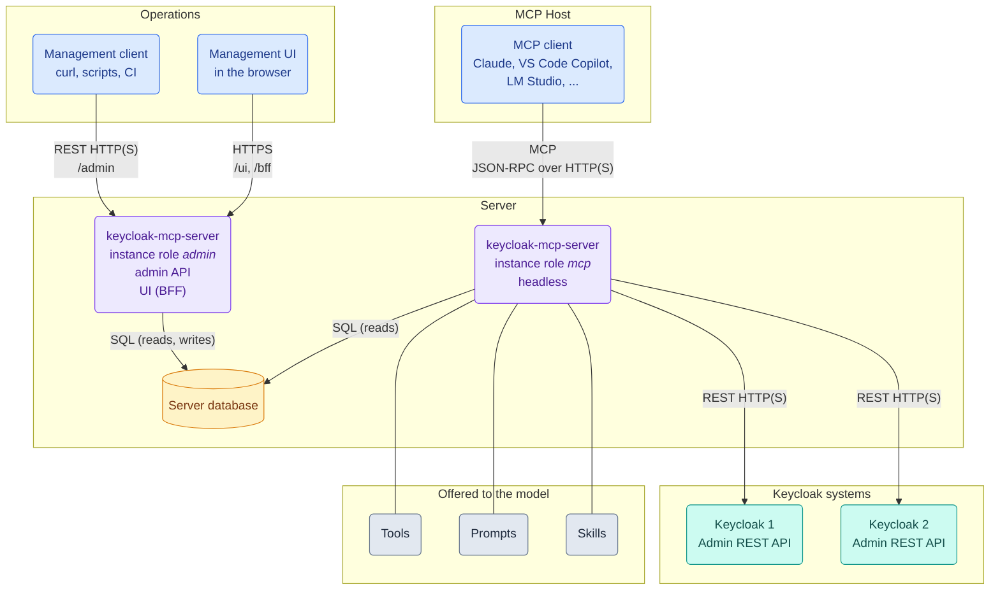

# Architecture: one server, two instance roles

The server is one program that can run in two roles on the same database (`kc-mcp.instance-role`): the **MCP
instance** is what MCP clients and the models behind them talk to, the **admin instance** is where the server itself
is configured. A single instance with the role `all` (the default) does both; a shared deployment splits them, so that
nothing the MCP side can reach is able to change what the admin side set up.

## The parts

Who issues the tokens in this picture, and what the server is towards each of them:
[Identity providers, authorization servers and Keycloak systems](providers-and-systems.md).

| part | what it is | talks to |
|---|---|---|
| MCP client | Claude Code, Claude Desktop, VS Code with Copilot, LM Studio, Cursor, Codex on the MCP host, typically a person's workstation ([Integrations](integrations.md)) | the MCP instance, over streamable HTTP; the person logs in at Keycloak first |
| MCP instance | `kc-mcp.instance-role=mcp`: the MCP endpoint and nothing else, no admin API and no UI | the Keycloak systems' Admin REST API; the database, to read |
| tools and prompts | what the MCP instance offers the model: the Keycloak tools and the prompts ([Tools](tools.md)) | |
| Keycloak systems | the Keycloaks the server administers, static from the configuration or registered at runtime ([Several Keycloak systems](systems.md)) | |
| admin instance | `kc-mcp.instance-role=admin`: the admin API under `/admin` and, when enabled, the management UI with its backend-for-frontend; `/mcp` answers 404 | the database, to read and write |
| management client | anything that speaks REST to the admin API: `curl`, a script, a pipeline | the admin instance |
| management UI | the browser application for the same tasks ([Management UI](management-ui.md)) | the admin instance, which signs the person in and keeps the session |
| server database | systems, realms, secrets, signing keys, audit events, sessions ([Database storage](storage.md)) | |

## Why the split

- **Two database users.** The admin instance owns the schema, runs the migrations and writes systems, secrets and
  keys. The MCP instance's user reads them, appends audit rows and keeps the short-lived state of its calls
  (approvals, rate limits). It may not change a system, add a secret or replace a key, and it reads neither the audit
  rows nor the UI's sessions. Even a compromised MCP instance cannot rewrite what the admin side configured.
- **Two networks.** The MCP instance sits behind the public ingress; the admin instance stays on the internal
  network. MCP clients, and the models behind them, never reach the admin API.
- **Two audiences.** A token issued for the MCP endpoint does not open the admin API and the other way round, even
  on an instance that serves both.
- **Whose roles.** In delegation mode `exchange` the MCP instance sends neither its own nor the person's token to a
  Keycloak, but a delegated one Keycloak issued for the two together: Keycloak enforces that person's roles on every
  call ([Security](security.md)).

What each side can and cannot do, table by table and request by request:
[Several instances on one database](storage.md#several-instances-on-one-database) and the runnable
[`examples/split-deployment`](../examples/split-deployment/). The other ways the server runs, each with a diagram:
[Scenarios in pictures](scenarios.md).
