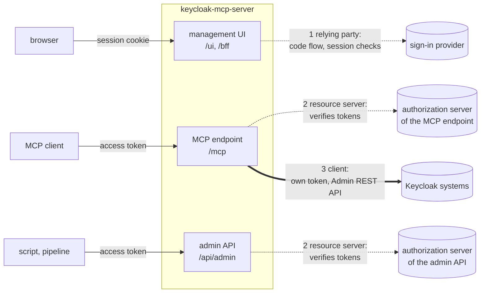

# Identity providers, authorization servers and Keycloak systems

[keycloak-mcp-server](../README.md) › documentation

The server deals with three kinds of parties that issue or accept tokens, and it plays a different part towards
each. They are configured separately and may be three different products, or one and the same Keycloak realm. This
page names them, as the rest of the documentation does.

| | the party | the server is its | used for | may be |
|---|---|---|---|---|
| 1 | **sign-in provider**: an OpenID Provider | relying party | signing people in to the management UI | Keycloak, Microsoft Entra ID, Okta, Auth0, Google, ... |
| 2 | **authorization server**: issues the access tokens the server accepts | resource server | the MCP endpoint and the admin API, each with an authorization server of its own | Keycloak; for the admin API, and the MCP endpoint without delegation, another OAuth authorization server |
| 3 | **Keycloak system**: a Keycloak the server administers | OAuth client, and client of its Admin REST API | everything the tools do | Keycloak only |

## 1. Sign-in providers: the server as relying party

Only the [management UI](management-ui.md) signs anyone in. The server runs the authorization code flow with PKCE at
the provider, keeps the tokens in its database and gives the browser a session cookie. Afterwards it calls the
provider itself: to refresh the tokens (the session check) and to verify back-channel logout tokens.

| setting | meaning |
|---|---|
| `kc-mcp.ui.oidc.issuer` | the provider; default `kc-mcp.admin.oauth.issuer`, else `kc-mcp.mcp.oauth.issuer` |
| `kc-mcp.ui.oidc.client-id`, `kc-mcp.ui.oidc.client-secret` | the server's client there, `keycloak-mcp-ui` by default |
| `kc-mcp.ui.oidc.idps.<alias>.*` | several providers, one sign-in button each |
| `kc-mcp.ui.operator-role`, `kc-mcp.ui.viewer-role` | the roles that open the UI: operator and viewer, read from the provider's access token |

- **What the provider has to offer:** OpenID Connect discovery, the code flow with PKCE, and an access token that is
  a JWT the server can verify with the provider's keys. The roles are read from that access token: Keycloak's
  `realm_access` and `resource_access` claims (`realm:<role>`, `<client>.<role>`), or a `groups` claim, whose values
  count as `realm:<value>` (the claim Quarkus OIDC reads by default; no test covers it).
- **What it does not have to be:** one of the Keycloak systems. A company's Entra ID tenant can sign the operators
  in while the server administers Keycloaks that know nothing of them. Nothing a person does in the UI is sent to a
  Keycloak system with their token.
- Refresh tokens and logout differ per provider: [Providers without a refresh token](management-ui.md#providers-without-a-refresh-token).
- Tested with Keycloak, one provider and two. The settings for other providers follow their documentation and
  were not run against them.

## 2. Authorization servers: the server as resource server

The server offers two protected resources. Each accepts bearer access tokens of one authorization server, and the
two are configured independently. A token for one never opens the other.

### The MCP endpoint

Off by default: the endpoint is anonymous until `kc-mcp.mcp.oauth.enabled=true`
([Callers](security.md#callers)).

| setting | meaning |
|---|---|
| `kc-mcp.mcp.oauth.enabled` | `true`: callers need an access token |
| `kc-mcp.mcp.oauth.issuer` | the authorization server; default: the auth realm of the default system |
| `kc-mcp.mcp.oauth.audience` | the audience a token must carry: only tokens issued for this server |
| `kc-mcp.mcp.oauth.resource-metadata.authorization-server` | where MCP clients are sent to log in (protected resource metadata, RFC 9728) |
| `kc-mcp.systems.<name>.trusted-issuers` | further issuers whose tokens may be exchanged at that system |

- An entry for one system or realm, `/mcp/systems/<system>[/<realm>]`, accepts the tokens of that system's realm
  and names it in its own protected resource metadata ([Entries](systems.md#entries-per-system-or-realm-mcpsystemssystemrealm)).
  Here the authorization server is always the Keycloak system itself.
- With `kc-mcp.delegation=exchange` the caller's token is exchanged at the Keycloak system for a delegated one. So
  the authorization server has to be that Keycloak, the realm that issued the token. Another identity provider can
  still stand in front of it: the user logs in there, Keycloak brokers the login or redeems the provider's
  assertion ([Cross-App Access](scenarios.md#4-cross-app-access-the-enterprise-idp-vouches-for-the-user)), and the
  token the server sees is Keycloak's.
- With `kc-mcp.delegation=off` the token only says who calls: it is verified, the caller is named in the audit
  trail, and the tools run with the system's service account. The authorization server need not be a Keycloak
  system then, as far as the server is concerned; this was only run with Keycloak.

### The admin API

Off by default (`kc-mcp.admin.enabled`). [Admin API](systems.md#admin-api-registering-systems-at-runtime).

| setting | meaning |
|---|---|
| `kc-mcp.admin.oauth.issuer` | the authorization server |
| `kc-mcp.admin.oauth.audience` | the audience a token must carry |
| `kc-mcp.admin.oauth.role` | the role it must carry, `realm:admin` by default |
| `kc-mcp.admin.token` | a static token instead of, or besides, an authorization server |

- It need not be a Keycloak system, nor the authorization server of the MCP endpoint. Roles are read as for the
  UI.
- The management UI does not go through the admin API: its backend performs the same operations for the signed-in
  person and has its own roles (`kc-mcp.ui.operator-role`, `kc-mcp.ui.viewer-role`). Two defaults tie them together
  for the common case of one realm for both: the UI's sign-in provider defaults to `kc-mcp.admin.oauth.issuer`, its
  operator role to `kc-mcp.admin.oauth.role`.
- An access token of the MCP endpoint's authorization server is refused here whatever roles it carries, unless
  both are configured as the same issuer; then give the two different audiences.

## 3. Keycloak systems: what the server administers

A [system](systems.md) is one Keycloak installation: `kc-mcp.systems.<name>.*` in the configuration (static), or
registered through the admin API and kept in the database (dynamic). Towards a system the server is a client:

| the server | with | setting |
|---|---|---|
| logs in as its own client in the system's auth realm | client credentials with a secret or `private_key_jwt`; locally also an admin user's password | `client-id`, `client-auth`, `grant-type`, `auth-realm` |
| exchanges a caller's token for a delegated one | token exchange, as that client | `kc-mcp.delegation=exchange` |
| calls the Admin REST API | its own or the delegated token, never the caller's | `url`, `allowed-realms` |
| asks for a step-up login or an approval | device or code flow, CIBA, at the system's realm | [Step-up](security.md#step-up-authentication), [CIBA](ciba-confirmation.md) |

Here Keycloak is at once the authorization server that issues the server's own tokens and the resource server whose
Admin REST API accepts them. This part cannot be another product.

## Which is which in the examples

| example | sign-in provider (UI) | authorization server: MCP endpoint | authorization server: admin API | Keycloak systems |
|---|---|---|---|---|
| `run-modes`, `delegated-auth`, `ciba-confirm`, `step-up-passkey` | realm `demo` | realm `demo`, where callers log in (`run-modes`: only `user-login.env` and `shared.env`) | | the same Keycloak, realm `demo` |
| `management-ui` | realm `demo`, or the realms `demo` and `master` as two providers | | realm `demo` | registered in the UI |
| `dynamic-systems` | realm `master` of the first Keycloak | second server, `:8093`: realm `master` at the root, realm `acme-dev` at the entry of `acme` | realm `master` | `acme`: the first Keycloak; `globex`: a second one that is nothing else |
| `xaa` | | realm of the Keycloak, behind an enterprise IdP | | the same Keycloak |

One Keycloak realm in all three parts is the simplest setup and a common one. They come apart as soon as the people
who operate the server are not the people who administer the Keycloaks, or the server administers Keycloaks of
several organisations.

## Addresses: where the server reaches a party and what its tokens say

For each party there is the address the server reaches it at and the issuer its tokens carry. They differ when the
server reaches the party through an internal address, as in a container network.

| party | the server reaches it at | the issuer its tokens carry |
|---|---|---|
| sign-in provider | `kc-mcp.ui.oidc.issuer`, `kc-mcp.ui.oidc.idps.<alias>.issuer` | read from the provider's discovery document |
| authorization server of the MCP endpoint | `kc-mcp.mcp.oauth.issuer` | `kc-mcp.mcp.oauth.token-issuer`; `kc-mcp.mcp.oauth.resource-metadata.authorization-server` is what MCP clients are told |
| authorization server of the admin API | `kc-mcp.admin.oauth.issuer` | read from its discovery document |
| Keycloak system | `kc-mcp.systems.<name>.url` | `kc-mcp.systems.<name>.issuer` |

The browser and the MCP client always use the public address. The server's own calls (discovery, keys, token
endpoint, Admin REST API) go to the configured one, and each host has to pass `kc-mcp.allowed-hosts`.

## Other parties

Not one of the three, each configured where it is used:

- the policy decision point of the [AuthZEN access check](authzen.md), and the authorization server whose tokens it
  accepts (`token-url`): the server is a client there
- an identity provider in front of a Keycloak system (brokering, Cross-App Access): Keycloak's business, the server
  only sees Keycloak's tokens
- the database and the OpenTelemetry collector, which take no part in any login
