# Scenarios in pictures

[keycloak-mcp-server](../README.md) › documentation

The ways the server is run, as diagrams: who talks to whom, which token carries each call, and where state lives.
Every scenario has a runnable example; the text next to each diagram names it and the page that explains the details.

In the flowcharts the colours mean the same throughout: blue for clients and people, violet for the server, teal for
Keycloak, amber for infrastructure. In the sequence diagrams the grey bands mark the phases of the flow.

## 1. One administrator, a service account

The local setup of the quick start's fallback (`examples/run-modes/env/realm-admin.env`): the server holds a
confidential client's credentials, every call runs with that service account, and its `realm-management` roles are the
ceiling. Nobody logs in; the MCP endpoint is anonymous and guarded against DNS rebinding instead.

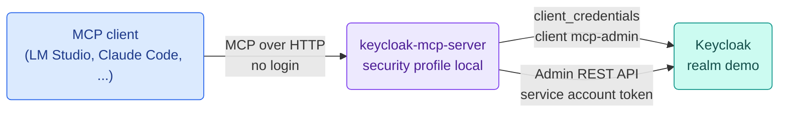

[Security](security.md#the-two-profiles) (security profiles, access levels), [Configuration](configuration.md).

## 2. Users log in, their token is forwarded

The quick start and the shape a shared server has (`examples/run-modes/env/user-forward.env`, `KC_MCP_DELEGATION=forward`).
The MCP endpoint answers 401 with protected resource metadata, the client logs the user in at Keycloak with the
authorization code flow and PKCE, and the server passes the user's own token on to the Admin REST API. The server holds
no admin credentials; Keycloak enforces the user's roles on every call.

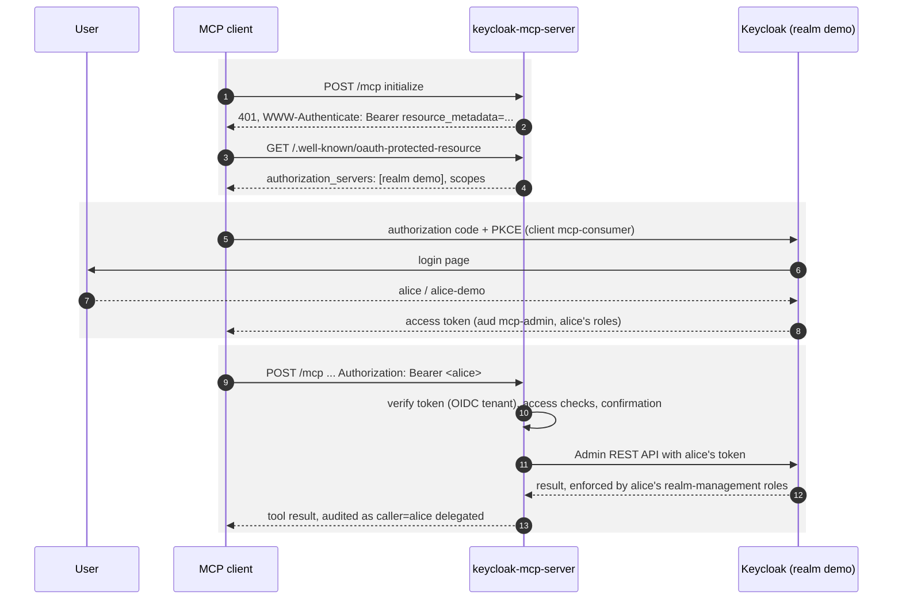

[Integrations](integrations.md) (the login's client side), [Security](security.md#callers).

## 3. The server as a delegated agent

`KC_MCP_DELEGATION=exchange` (`examples/delegated-auth/`): the user consents to the server's client acting for them, and
Keycloak's token exchange delegation issues a token that names both, `sub` the user and `act` the server's client. The
server's own role scope caps every delegated token, and Keycloak's events record who acted for whom.

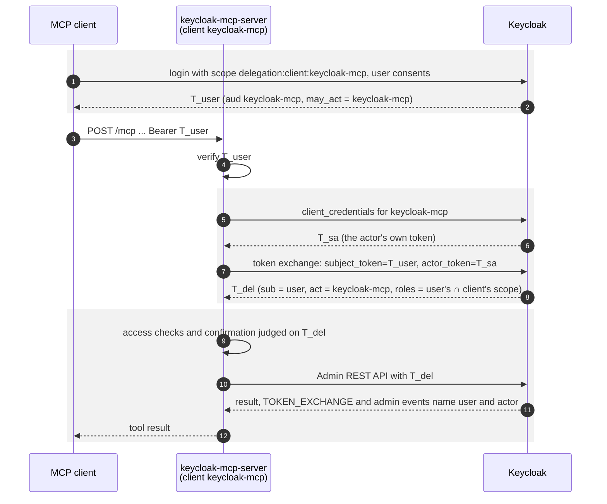

[Security](security.md#callers), the example's README for the Keycloak setup (consent, Standard Token Exchange,
the `delegate` permission).

## 4. Cross-App Access: the enterprise IdP vouches for the user

`examples/xaa/`, MCP Enterprise-Managed Authorization: the client trades the user's SSO identity for an ID-JAG at the
enterprise IdP and redeems it at Keycloak with the JWT authorization grant. There is no login page and no consent screen
of Keycloak; the IdP's policy decides whether this agent may connect for this user, Keycloak's roles decide what they may
do. The server is a resource server as in scenario 2 (`KC_MCP_DELEGATION=forward`).

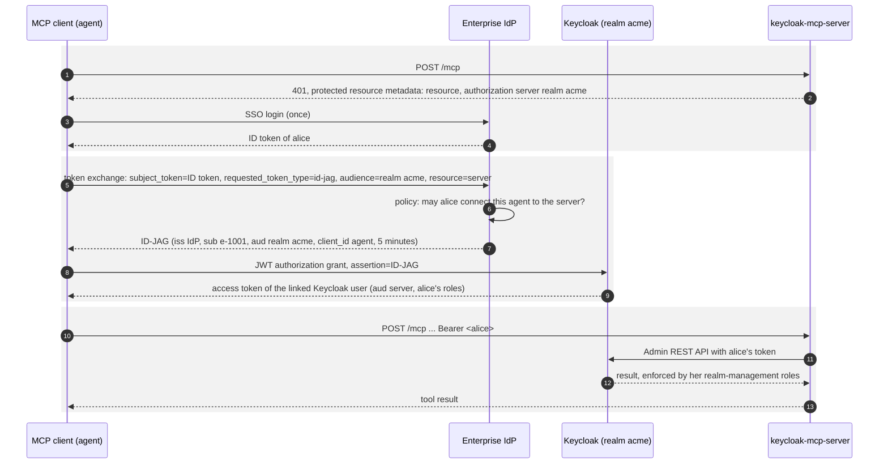

A user the IdP's policy leaves out gets `access_denied` from the IdP, one without a linked Keycloak account
`User not found` from Keycloak; the server sees neither. The example's README has the Keycloak and IdP setup.

## 5. Several Keycloak systems, one entry per system or realm

Every Keycloak the server administers is a named system (`kc-mcp.systems.<name>.*`, a systems file, or the admin API).
A client at the root names the system in each call; a client bound to an entry does not and cannot reach another one.
Each entry logs its users in at its own realm: the server resolves an OIDC tenant per entry, so a token of Keycloak A
never reaches Keycloak B, unless B's `trusted-issuers` explicitly allow it.

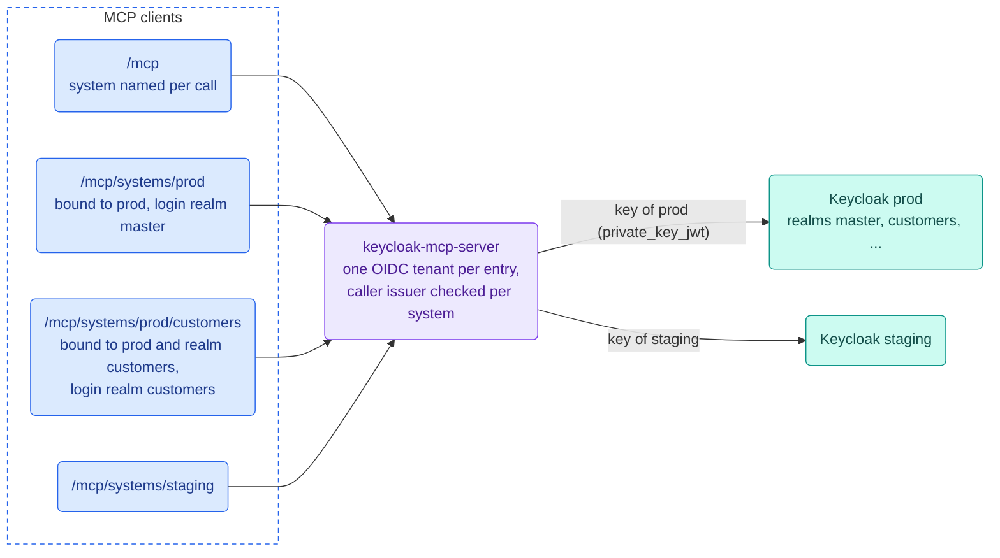

[Several Keycloak systems](systems.md), `examples/multi-tenant/`.

## 6. A shared server per environment

One deployment per environment behind a load balancer, several instances on one database: systems, keys, secrets,
pending approvals, UI logins and the audit trail are shared; MCP sessions of older clients stay on the instance that
opened them. `kc-mcp.instance-role` splits what an instance serves (`examples/split-deployment/`): the `mcp` instances
behind the public ingress serve only the MCP endpoint, one `admin` instance on the internal network serves the admin API
and the management UI. The two accept tokens of different audiences, and they use different database users, so even a
compromised MCP instance cannot change what the admin side configured.

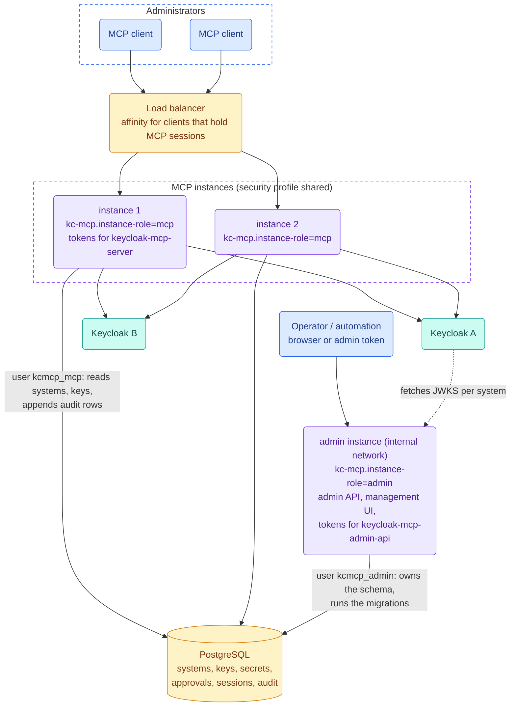

`/admin` answers 404 on an `mcp` instance and `/mcp` on the `admin` one; switching either back on explicitly stops the
start instead of quietly winning. [Database storage](storage.md#several-instances-on-one-database),
[Security](security.md#the-two-profiles) (security profile `shared`, instance roles).

## 7. Registering a system at runtime

With the database storage and the admin API on (`examples/dynamic-systems/`), a system is registered with one request,
or with *Add system* in the management UI (scenario 8), which sends the same request through its BFF.
The server creates the system's `private_key_jwt` key in its vault and publishes the public key per system; Keycloak's
client is configured with that JWKS URL, so no secret changes hands.

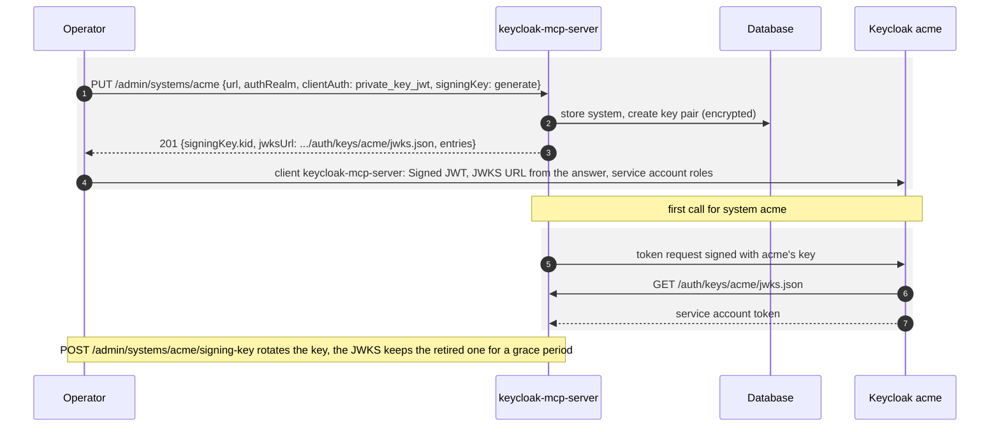

[Several Keycloak systems](systems.md#admin-api-registering-systems-at-runtime), the OpenAPI document at `/q/openapi`.
`bin/kcmcp.sh start-dev` of a distribution brings the database and `kc-mcp.dynamic-systems=true` along
([Development mode](configuration.md#development-mode-start-dev)).

## 8. The management UI: the server signs people in

`examples/management-ui/`: a browser UI at `/ui` for systems, their realms and signing keys, with a backend-for-frontend
under `/bff`. The server is the OpenID Connect relying party; the browser holds only an HttpOnly cookie with an opaque
id, and the tokens stay in the database, encrypted like the other secrets. The operator role (`kc-mcp.admin.role`) may
read and write, an optional viewer role only read; the BFF enforces that, the UI only hides what the user may not do.

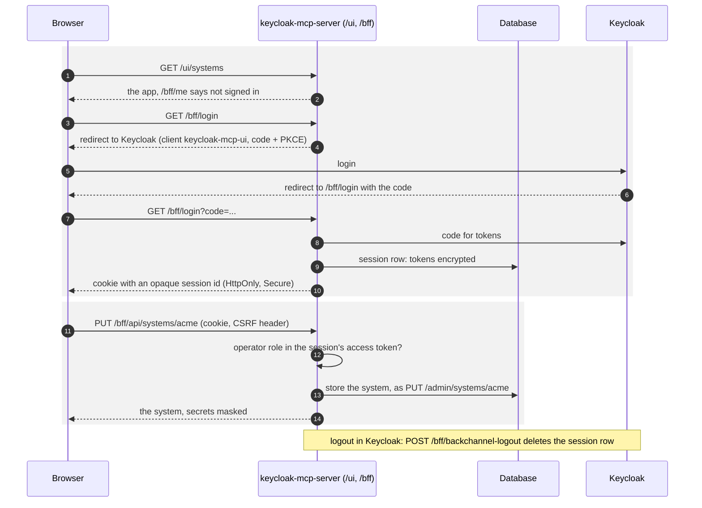

[Management UI](management-ui.md) (roles, several identity providers, sessions),
[Development](development.md#management-ui) (working on the UI).

## 9. Approval on the user's device (CIBA)

The built-in `ciba` confirmer (`examples/ciba-confirm/`) takes the decision on a destructive tool out of the channel the
model controls: the server files a backchannel authentication request for the signed-in user, the chat shows a number,
the device shows what is asked and has the user enter that number, and the tool runs once the user approved there.

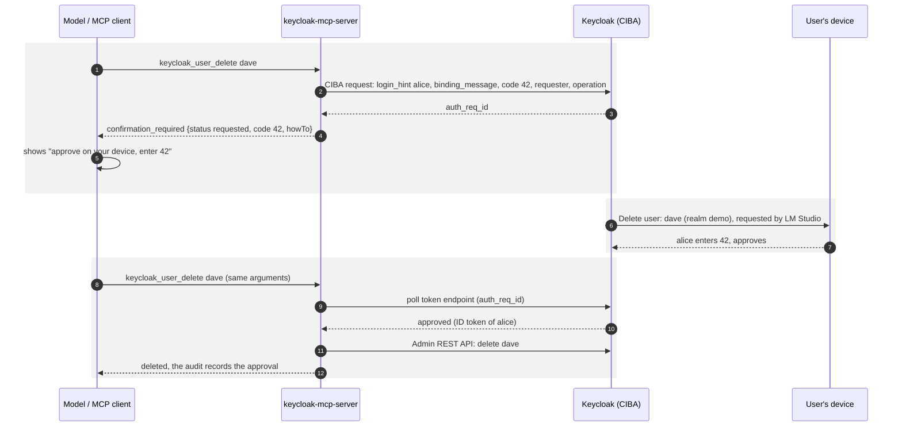

[CIBA confirmation](ciba-confirmation.md).

## 10. Troubleshooting with read-only access

`examples/troubleshooting/`: a support engineer asks why a login misbehaves, and the model answers from what Keycloak
records and how it is configured. The server cannot change anything, twice over: its service account holds only
`view-*` roles, and `KC_MCP_READ_ONLY=true` leaves the read tools only and sends nothing but `GET` to the Admin API.
A fix is proposed, not applied.

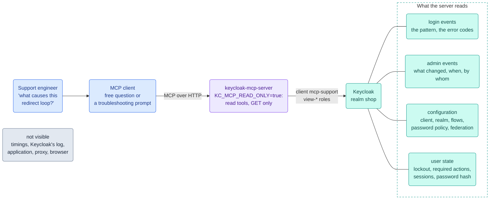

| question | prompt | decided by |
|---|---|---|
| What causes this redirect loop? | `keycloak_redirect_loop_troubleshoot` | the pattern of the client's login events (`LOGIN` and `CODE_TO_TOKEN_ERROR` taking turns, both succeeding, `LOGIN_ERROR`, none), then the client's settings and what the admin events say was changed before |
| Why can't the user sign in? | `keycloak_login_troubleshoot` | the user's state, the error codes of their login events, the lockout status |
| Why is the login so slow? | `keycloak_slow_login_troubleshoot` | settings that cost time: password hashing, federation, identity providers, flow steps, event listeners; the Admin API has no timings, so the answer ranks candidates and says what to measure |

The example's realm has one planted fault per question and a script that produces the symptoms.
[Tools](tools.md#prompts) (the prompts), [Security](security.md#tool-restrictions-per-system-and-realm) (read-only for
the server, a system or a realm).

## 11. What every call goes through

Whatever the scenario, a tool call runs the same pipeline; a refusal at any step is a structured error that says what to
do next, and is audited like any other outcome. An outside policy service comes after the server's own checks, so it can
only take away what Keycloak's roles allow, never add to it.

```mermaid
flowchart LR
    A("tool call") --> B("static policy<br/>read-only mode,<br/>tool and category lists")
    B --> C("entry binding, arguments<br/>system and realm pinned?<br/>validation, coercion")
    C --> D("target<br/>system and realm resolved,<br/>explicit target")
    D --> E("per-call access<br/>allowed realms, roles,<br/>access checks (policies, self-protection)")
    E --> X("external authorization<br/>an AuthZEN PDP, when the<br/>system or realm asks for it")
    X --> F("confirmation<br/>elicitation, confirm flag,<br/>Confirmer, CIBA")
    F --> G("handler<br/>Admin REST API with the<br/>identity of the scenario")
    G --> H("audit<br/>caller, tool, outcome, refusals too,<br/>secrets redacted")
    classDef client fill:#dbeafe,stroke:#2563eb,color:#1e3a8a
    classDef server fill:#ede9fe,stroke:#7c3aed,color:#4c1d95
    classDef keycloak fill:#ccfbf1,stroke:#0d9488,color:#134e4a
    classDef infra fill:#fef3c7,stroke:#d97706,color:#78350f
    classDef confirm fill:#ffe4e6,stroke:#e11d48,color:#881337
    classDef audit fill:#e2e8f0,stroke:#64748b,color:#1e293b
    class A client
    class B,C,D,E,X server
    class F confirm
    class G keycloak
    class H audit
```

[Tools](tools.md), [Security](security.md), [External authorization](authzen.md), [Extending](extending.md) (your own
checks, authorization engines and confirmers).
